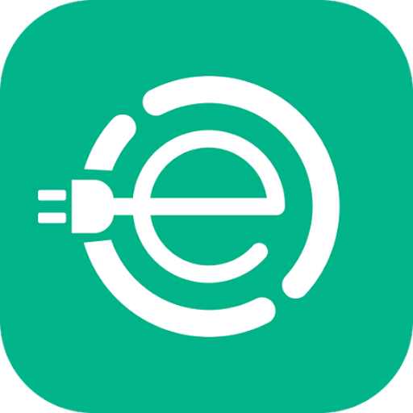

# EasyWallbox (BLE) para Home Assistant

[](https://hacs.xyz/)
[](https://github.com/jesusgarrigues/ha-easywallbox/actions/workflows/validate.yaml)

Integración personalizada (instalable con **HACS**) para controlar el cargador
**EasyWallbox** (eSolutions / Free2Move / Fimer) por **Bluetooth LE** desde Home
Assistant, usando un **repetidor Bluetooth en el garaje** (un ESP32 con
[ESPHome Bluetooth Proxy](https://esphome.io/components/bluetooth_proxy.html)).

Basada en el protocolo y la lógica de control de
[paolofaz/Easywallbox---Esphome](https://github.com/paolofaz/Easywallbox---Esphome)
(MIT) y en el trabajo de [mihaistana/easywallbox](https://github.com/mihaistana/easywallbox).

```
 ┌──────────────┐  BLE   ┌──────────────────────┐  WiFi / API  ┌────────────────┐
 │ EasyWallbox  │◄──────►│ ESP32 en el garaje   │◄────────────►│ Home Assistant │
 │  (garaje)    │        │ (Bluetooth proxy)    │   ESPHome    │ + esta integr. │
 └──────────────┘        └──────────────────────┘              └────────────────┘
```

A diferencia del firmware ESPHome original, aquí **el ESP32 es un repetidor
genérico**: toda la lógica vive en Home Assistant. El mismo proxy sirve también
para otros dispositivos Bluetooth del garaje, y si Home Assistant tiene su propio
adaptador Bluetooth al alcance, también funciona sin proxy.

---

## 1. Montar el repetidor Bluetooth del garaje

### Hardware
- Cualquier ESP32 con Bluetooth (ESP32‑WROOM DevKit, M5Stack Atom Lite, ESP32‑S3…).
  Si la WiFi del garaje es floja, mejor uno con Ethernet (Olimex ESP32‑POE, WT32‑ETH01).
- Colócalo a pocos metros del cargador, fuera de cajas metálicas.

### Firmware
1. En Home Assistant instala el complemento **ESPHome Device Builder**.
2. Crea un dispositivo nuevo y pega el contenido de
   [`esphome/garage-bluetooth-proxy.yaml`](esphome/garage-bluetooth-proxy.yaml).
3. Cambia `wallbox_mac` por la MAC de tu cargador y añade en `secrets.yaml`:
   `wifi_ssid`, `wifi_password`, `api_encryption_key` y `ota_password`.
4. Instálalo en el ESP32 (la primera vez por USB, después por OTA).
5. Home Assistant lo detectará: añádelo con la integración **ESPHome**.

> El EasyWallbox exige un enlace cifrado con passkey fija (`P:` del QR,
> normalmente `001234` → `1234`). El YAML incluye un pequeño `ble_client`
> **que no se conecta por sí mismo** (`auto_connect: false`): solo responde esa
> passkey cuando Home Assistant abre la conexión a través del proxy.

---

### Opcional: saber si el Tesla está en la plaza
El mismo proxy puede detectar tu Tesla **solo escuchando** los anuncios Bluetooth
que el coche emite siempre (también dormido, para la llave del móvil). No se
conecta, no despierta el coche ni gasta su batería, y no ocupa conexiones del
proxy. Crea en ESPHome el sensor **"Tesla en la plaza"** (y "Tesla señal BLE"
como diagnóstico).

1. **Nombre Bluetooth del coche** (`tesla_ble_name`): tiene la forma
   `S` + 16 caracteres hexadecimales + `C`. Búscalo en *Ajustes → Dispositivos y
   servicios → Bluetooth → Anuncios* con el coche aparcado, o calcúlalo con tu VIN
   (en tu ordenador; no hace falta compartirlo):
   ```bash
   python3 -c "import hashlib; v=input('VIN: ').strip().upper(); print('S'+hashlib.sha1(v.encode()).hexdigest()[:16]+'C')"
   ```
2. **Ajusta `tesla_rssi_min`**: con el coche en la plaza mira "Tesla señal BLE"
   (p. ej. −70 dBm) y pon unos 10 dB menos (−80). Así no cuenta un Tesla en la
   plaza de al lado o pasando por la calle.
3. `tesla_timeout_s` (180 s por defecto): tiempo sin oírlo para darlo por ido.

Complementa al sensor *Coche conectado* del cargador, que solo indica si el
cable está enchufado.

---

## 2. Instalar la integración con HACS

1. HACS → menú ⋮ → **Repositorios personalizados**.
2. Repositorio: `https://github.com/jesusgarrigues/ha-easywallbox` — Tipo: **Integración**.
3. Busca **EasyWallbox (BLE)**, descárgala y **reinicia Home Assistant**.

[](https://my.home-assistant.io/redirect/hacs_repository/?owner=jesusgarrigues&repository=ha-easywallbox&category=integration)

Instalación manual: copia `custom_components/easywallbox` en
`<config>/custom_components/` y reinicia.

---

## 3. Configurar

**Cierra la app del fabricante en el móvil**: el cargador solo admite una
conexión BLE a la vez.

Cuando el proxy vea el cargador (nombre `eWB…`), Home Assistant mostrará
**"Descubierto: EasyWallbox"**. Si no, ve a *Ajustes → Dispositivos y servicios →
Añadir integración → EasyWallbox (BLE)* y elige el cargador o introduce la MAC.

Te pedirá el **PIN BLE**: escanea el QR de la etiqueta del cargador, verás algo
como

```
BT:N:2911AA00101728;M:F2ME.EWE08APEFXX;D:eWB01728;P:001234;A:9844;;
```

El PIN es el campo **`A:`** (aquí `9844`). `P:` es la passkey de emparejamiento
(va en el YAML del proxy). Si abrir la caja del cargador implica acceder a partes
eléctricas, corta la alimentación antes o pide ayuda a un profesional.

### Opciones
| Opción | Por defecto | Descripción |
|---|---|---|
| Intervalo de sondeo | 30 s | Cada cuánto se leen telemetría y límites |
| Corriente máxima de los deslizadores | 32 A | Máximo de los controles numéricos |
| Límite DPM por defecto al reanudar | 26 A (~6 kW) | Se usa si no se conoce un límite DPM previo |
| Solicitar emparejamiento BLE | Sí | Desactívalo solo si tu adaptador falla al emparejar |

---

## Entidades

| Tipo | Entidad | Descripción |
|---|---|---|
| switch | **Carga** | Pausa/reanuda la carga poniendo el límite DPM a 0 A / restaurando el último válido |
| number | **Corriente de carga** | Límite de corriente del coche (EEPROM 174) |
| number | Límite casa (DPM) | Límite total casa + coche (EEPROM 158). *Deshabilitada por defecto* |
| sensor | Estado de carga | Cable desconectado / En pausa / Vehículo listo / Cargando / Error |
| sensor | Potencia de carga, Energía y Duración de la sesión | Medidas del cargador |
| sensor | Potencia / Corriente casa (DPM) | Consumo total medido por la pinza DPM |
| sensor | Corriente de carga fijada, Límite DPM fijado | Valores **confirmados** por el cargador |
| sensor (diag.) | Tensión control pilot, Corriente ofrecida, Límite seguro, Última respuesta BLE | Diagnóstico |
| binary_sensor | Conexión BLE, Cargando, Coche conectado, Carga habilitada, DPM activo, Fallo | |
| button | Actualizar datos, Reconectar BLE | |

Servicio avanzado **`easywallbox.send_command`**: envía un comando crudo del
protocolo (p. ej. `$EEP,READ,IDX,156`) y devuelve la respuesta. ⚠️ Puede
modificar la EEPROM; **no desactives nunca el DPM** si dependes de él para
proteger tu instalación.

### Sobre el interruptor de carga (importante)
Igual que el firmware original, **requiere DPM instalado y activado**: la pausa
se hace con `$EEP,WRITE,IDX,158,0`. Los comandos nativos `$CMD,CHARGE,STOP/START`
no se usan porque en algunos cargadores impiden reanudar sin desenchufar el cable.
Home Assistant no sustituye a las protecciones eléctricas.

### Ejemplo: cargar con excedentes solares
```yaml
automation:
  - alias: "Wallbox - ajustar a excedentes"
    trigger:
      - platform: time_pattern
        minutes: "/2"
    action:
      - service: number.set_value
        target:
          entity_id: number.easywallbox_corriente_de_carga
        data:
          value: >
            
            {{ [6, [ (w / 230) | round(0, 'floor'), 32 ] | min ] | max }}
```

---

## Solución de problemas
- **"No está al alcance"**: en *Ajustes → Dispositivos → Bluetooth* comprueba que
  el proxy del garaje ve el cargador (y con qué RSSI; mejor que −85 dBm).
- **No conecta / se queda en "Conexión BLE: desconectado"**: cierra la app del
  fabricante, pulsa *Reconectar BLE* y revisa los logs del proxy en ESPHome
  (debe aparecer la petición de passkey). Si tu proxy no gestiona el
  emparejamiento, prueba a desactivar la opción *Solicitar emparejamiento BLE*.
- **PIN rechazado**: Home Assistant mostrará una reautenticación; usa el campo `A:`.
- Logs detallados:
  ```yaml
  logger:
    logs:
      custom_components.easywallbox: debug
  ```

## Icono
El icono de la integración está en `custom_components/easywallbox/brand/`
(Home Assistant 2026.3 o superior lo muestra automáticamente; en versiones
anteriores aparece el icono genérico). Es el logotipo de la app de eSolutions
para el EasyWallbox: marca registrada de su propietario, usada solo para
identificar el cargador compatible; este proyecto no es oficial. Hay un icono
alternativo propio (sin marcas) en [`docs/icon-alternativo.svg`](docs/icon-alternativo.svg).

## Desarrollo
```bash
pip install -r requirements_test.txt
pytest
```

## Créditos y licencia
- Protocolo y lógica DPM: [paolofaz/Easywallbox---Esphome](https://github.com/paolofaz/Easywallbox---Esphome) (MIT).
- Descubrimiento del protocolo y del PIN: [mihaistana/easywallbox](https://github.com/mihaistana/easywallbox).
- Licencia: MIT. Proyecto no oficial, sin relación con eSolutions, Free2Move ni Fimer.
